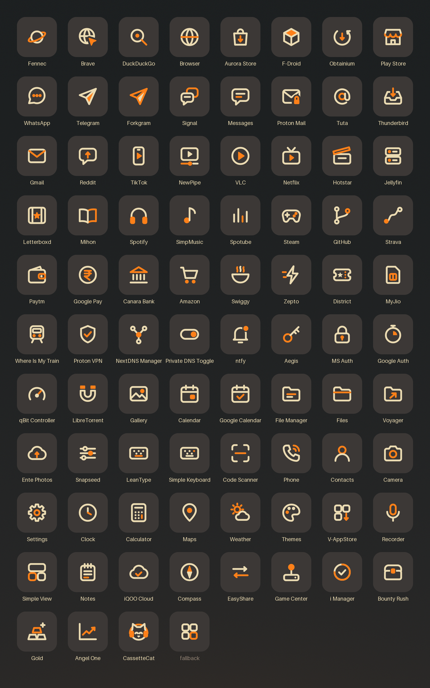
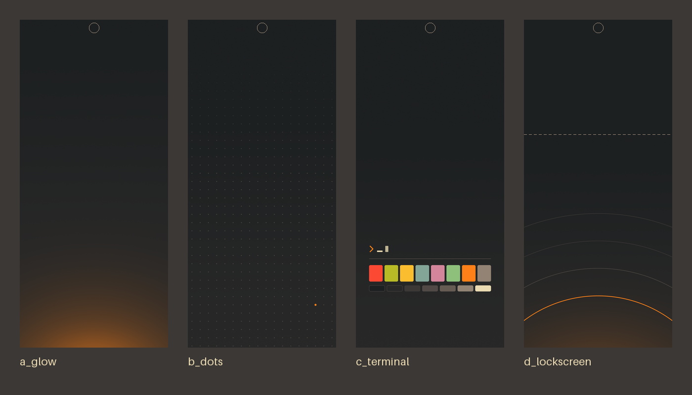

# Gruvbox Clean: icon pack and wallpapers for Android

A flat, minimal [Gruvbox](https://github.com/morhetz/gruvbox) dark theme for Android:
**84 original icons**, four wallpapers and a lock-screen wallpaper. It works with Nova Launcher,
Lawnchair and any launcher that supports ADW / Nova icon packs.

I use it daily with **Nova Launcher** on an iQOO (vivo OriginOS, Android 16).





## Download

Get the latest APK from **[Releases](https://github.com/sabarinathan1611/gruvbox-mobile-icons/releases/latest)**,
install it, then apply it from your launcher. The wallpapers are attached to each release and
are also in [`wallpapers/`](wallpapers).

## Apply in Nova Launcher

1. Open **Nova Settings → Look & feel → Icon style → Icon theme** and choose **Gruvbox Clean**.
2. Change a single icon: long-press the app → **Edit** → tap the icon → **Gruvbox Clean**, then
   use the search box at the top to find an icon.
3. Apps without a custom icon keep their own logo, shrunk onto a matching Gruvbox tile.

**Lawnchair**: Home settings → General → Icon pack → Gruvbox Clean (turn off *Themed icons*).

## Nova Launcher colour setup (hex)

Set these in Nova Settings to match the icons. Menu names move a little between Nova versions;
look for the same item nearby.

| Nova setting | Where | Hex |
|---|---|---|
| Dock background | Dock → Dock background → Color | `#282828` (about 20% transparency) |
| App drawer background | App drawer → Background → Color | `#1d2021` (0–10% transparency) |
| App drawer / home icon labels | App drawer (or Home screen) → Icon layout → Label → Color | `#ebdbb2` |
| Folder background | Folders → Background → Color | `#3c3836` |
| Folder icon background | Folders → Folder icon → Background color | `#3c3836` |
| Search bar | Home screen → Search bar style → Bar color | `#3c3836` |
| Search bar logo / icons | Home screen → Search bar style → Logo / icon color | `#fe8019` |
| Accent / scroll highlight | Look & feel → Accent color (if shown) | `#fe8019` |
| Notification dots | Notification badges → Dots → Color | `#fe8019` |
| Night mode | Look & feel → Night mode | Always on |

Wallpapers: home screen `gruvbox_clean_a_glow` / `b_dots` / `c_terminal`,
lock screen `gruvbox_clean_d_lockscreen` (top 35% left empty for the clock).

## Palette

| Role | Name | Hex |
|---|---|---|
| Background (darkest) | bg0_h | `#1d2021` |
| Background | bg0 | `#282828` |
| Icon tile, surfaces | bg1 | `#3c3836` |
| Borders, inactive | bg2 / bg3 | `#504945` / `#665c54` |
| Text, icon lines | fg | `#ebdbb2` |
| Bright text | fg0 | `#fbf1c7` |
| Muted text | gray | `#928374` |
| **Accent** | orange | `#fe8019` |
| Other Gruvbox colours | red / green / yellow / blue / purple / aqua | `#fb4934` `#b8bb26` `#fabd2f` `#83a598` `#d3869b` `#8ec07c` |

## Icon style

- Rounded-square tile in `#3c3836` with a 22% corner radius.
- A glyph on a 24-unit grid with a 2-unit round stroke, drawn in `#ebdbb2` with one orange `#fe8019` accent.
- Flat shapes only: no gradients or shadows.
- Icons show what an app *does* (a cart, a paper plane, a gamepad); they never copy brand logos.
- Everything is generated from code in [`scripts/`](scripts); the SVG sources are in [`icons/svg/`](icons/svg).

## Docs

- [How to make an icon](docs/how-to-make-icons.md)
- [How to build the APK](docs/build-apk.md)
- [Contributing](docs/CONTRIBUTING.md): request or add an icon for your app

## Project layout

```
scripts/        palette, glyph artwork and the generators (Python)
icons/svg|png   one icon per app, plus fallback and iconback
wallpapers/     1080x2392 PNG wallpapers
mapping/        components.txt: launcher components mapped to icons
preview/        preview sheets
iconpack/       Android project (package com.sabari.gruvboxclean)
docs/           guides
```

## Credits

Colour palette: [Gruvbox](https://github.com/morhetz/gruvbox) by Pavel Pertsev (MIT licence).
All icons and wallpapers are original work made for this project.
